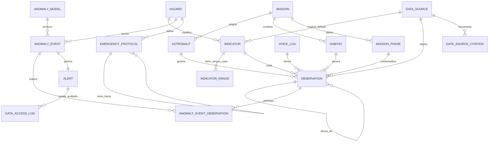

# GUARDIÁN — Modelo Entidad-Relación (v1)

> Ámbito activo de esta entrega: **distancia a la Tierra**, **aislamiento**, **campos gravitacionales**.
> El modelo queda preparado para activar **radiación** y **ambiente cerrado** sin cambiar el esquema
> (son catálogo, no estructura) — ver `Hazard.is_active_scope`.

## Principios de diseño (de los requisitos del equipo)

1. **Catálogo, no columnas fijas.** Indicadores, fuentes de datos y hazards son filas en tablas
   de catálogo (`indicator`, `data_source`, `hazard`), no columnas de una tabla gigante. Agregar
   un sensor nuevo = insertar una fila, no migrar el esquema.
2. **Cada observación es trazable.** Toda fila de `observation` lleva: astronauta (o hábitat, si es
   una lectura ambiental sin dueño individual), fecha/hora, unidad, método de medición, fase de
   misión (antes/durante/después) y **procedencia** (`REAL` / `SIMULATED` / `DERIVED`).
3. **Unidades distintas = filas distintas.** Calcio urinario en `mg/dL` y en `mg/24h` son dos
   `indicator` distintos (`URINARY_CALCIUM_MGDL`, `URINARY_CALCIUM_MG24H`), nunca se mezclan.
4. **No todo viene de un wearable.** `indicator.requires_equipment` y `indicator.default_method`
   documentan qué requiere laboratorio/equipo especial vs. qué es pasivo (audífono, saco, cámara).
5. **Las lecturas ambientales no son del astronauta.** CO₂ de cabina, temperatura lunar, distancia
   a la Tierra, etc. se cuelgan de `habitat`/`mission`, no de una persona — por eso
   `observation.astronaut_id` es **nullable** y existe `observation.habitat_id`.
6. **Cada indicador lleva su propia advertencia de validez.** `indicator.measurement_caveat`
   guarda frases como *"CO₂ de cabina ≠ CO₂ en sangre"* o *"radiación de Marte es de un rover, no
   de una nave tripulada"* — esto sale directo de las tablas que compartió el equipo y se muestra
   donde se use el dato, para que nadie lo sobre-interprete.
7. **La voz es una fuente más, no un hack.** `voice_log` guarda la transcripción cruda y el parseo;
   las observaciones derivadas de voz referencian `voice_log_id` y quedan con
   `data_origin='REAL'`, `data_source='VOICE_INPUT'`.
8. **La IA es explicable y reentrenable por contexto.** `anomaly_model` versiona un IsolationForest
   por contexto de misión (LEO / lunar / tránsito a Marte / superficie marciana); `anomaly_event`
   guarda el score y qué observaciones lo dispararon; `emergency_protocol` es un árbol de decisión
   (auto-referenciado) que traduce la alerta en una acción concreta — igual que pide la rúbrica:
   *resolver solo / avisar a la tripulación / contactar a la Tierra*.

## Diagrama (Mermaid)

## Tablas (resumen)

| Tabla | Rol | Expandible vía |
|---|---|---|
| `mission` | Misión (LEO / lunar / tránsito Marte / superficie Marte) | nuevos `destination` |
| `mission_phase` | PRE_FLIGHT / IN_FLIGHT / POST_FLIGHT + rango de fechas y `day_relative_to_launch` | nuevas fases |
| `astronaut` | Tripulante | — |
| `habitat` | Hábitat/nave (dueño de lecturas ambientales, no de una persona) | — |
| `hazard` | Los 5 peligros oficiales HRP; `is_active_scope` marca los 3 activos ahora | activar fila existente |
| `data_source` | Audífono, saco de dormir, baño, cámaras/cabina, EDA, RadLab, LRO-Diviner, MSL-REMS, DSN, Horizons, OSDR, MMASH, voz, simulación | nueva fila |
| `indicator` | Catálogo de variables medibles, con unidad default, método, caveat, hazard y fuente sugerida | nueva fila |
| `indicator_range` | Rangos normales (NASA OSDR/HRP) para z-score y reglas de anomalía | nueva fila |
| `observation` | **Tabla de hechos**: valor + astronauta/hábitat + fase + fuente + procedencia | — (es el núcleo) |
| `voice_log` | Transcripción cruda + payload parseado de la recolección por voz | — |
| `data_source_citation` | Cita formal de cada fuente NASA (obligatorio para el premio global) | nueva fila |
| `anomaly_model` | Registro de modelos IsolationForest por contexto de misión | nueva fila/versión |
| `anomaly_event` | Resultado de una corrida del modelo (score + hazard asociado) | — |
| `anomaly_event_observation` | Bridge N:M — qué observaciones explican el evento | — |
| `alert` | Semáforo (verde/amarillo/naranja/rojo) + acción recomendada + estado | — |
| `emergency_protocol` | Árbol de decisión auto-referenciado: hazard+nivel → instrucción concreta | nueva rama |
| `data_access_log` | Auditoría de acceso a datos de salud (manejo seguro) | — |

Detalle completo de columnas, tipos y constraints: ver `backend/app/models/` (SQLAlchemy, que es la
fuente de verdad ejecutable de este diagrama).
